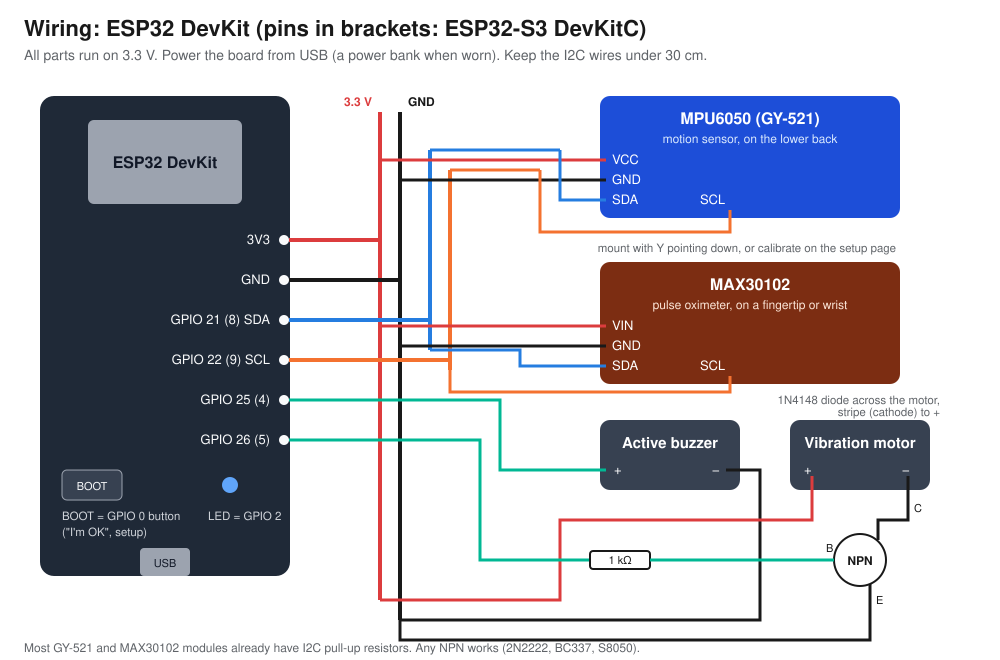

# Build and demonstrate the real device

This guide takes you from a bag of parts to a working demo: a worn ESP32 that detects
falls, collapses and abnormal vitals, and a web app on your laptop where alerts appear
and are acknowledged. No programming tools are needed: the firmware is flashed from the
browser and configured from a phone.

> **Prototype, not a medical or safety-certified device.** Use it for research and
> demonstrations only. Never ask anyone to fall for real except carefully, onto a
> mattress, with someone present.

## 1. Parts (about USD 15-25)

| Part | Notes |
|---|---|
| ESP32 DevKit (ESP32-WROOM-32, 38-pin "DevKitC" or 30-pin "DOIT" board) | Any ESP32 with Wi-Fi works. An ESP32-S3 DevKitC also works; its pins are in brackets below. |
| MPU6050 module (GY-521) | Accelerometer + gyroscope, the fall sensor. |
| MAX30102 module | Pulse oximeter (heart rate, SpO2). Optional: without it, falls and man-down still work. |
| Active buzzer, 3.3 V | "Active" = beeps by itself when powered. |
| Coin vibration motor, 3 V | Optional. |
| NPN transistor (2N2222, BC337 or S8050), 1 kΩ resistor, 1N4148 diode | Driver for the motor (a GPIO pin cannot drive a motor directly). |
| Breadboard and jumper wires, or a small perfboard | Keep the sensor wires under 30 cm. |
| USB cable **that carries data** (not charge-only) | For flashing. |
| USB power bank and an elastic belt or pouch | To wear the device. |

The button is the **BOOT** button already on the ESP32 board, and the status LED is the
board's blue LED (GPIO 2). You can add an external push button from GPIO 0 to GND.

## 2. Wiring



| From | ESP32 pin | ESP32-S3 pin |
|---|---|---|
| MPU6050 VCC and MAX30102 VIN | 3V3 | 3V3 |
| MPU6050 GND, MAX30102 GND, buzzer −, transistor emitter | GND | GND |
| MPU6050 SDA and MAX30102 SDA (shared I2C bus) | GPIO 21 | GPIO 8 |
| MPU6050 SCL and MAX30102 SCL | GPIO 22 | GPIO 9 |
| Buzzer + | GPIO 25 | GPIO 4 |
| 1 kΩ resistor to the transistor base | GPIO 26 | GPIO 5 |
| Motor +: 3V3; motor −: transistor collector; diode across the motor, stripe to + | | |
| Button ("I'm OK", setup) | GPIO 0 (BOOT button) | GPIO 0 (BOOT button) |
| Status LED | GPIO 2 (on the board) | none by default, see below |

Everything runs on **3.3 V**; do not connect the sensors to 5 V. Most GY-521 and
MAX30102 modules already have the I2C pull-up resistors. The ESP32-S3 DevKitC's on-board
LED is an RGB LED the firmware does not drive; add an LED with a 330 Ω resistor to a free
pin and set it in `menuconfig` if you build the firmware yourself.

**Where it is worn.** The model learned from the KFall dataset, where the sensor sits on
the **lower back**. Fix the board (or at least the MPU6050) to an elastic belt at the
lower back or the side of the waist. The MAX30102 needs skin contact: put it on a
fingertip with a short cable (or a strip of tape around the finger); on the back it will
not read a pulse. The orientation does not matter if you calibrate (step 5).

## 3. Flash the firmware (once)

### Easiest: from the browser

1. Install Python 3.9 or newer on your laptop (no extra packages are needed).
2. Get this repository (`git clone`, or *Code → Download ZIP* on GitHub) and open a
   terminal in its folder.
3. Download the ready-made firmware, then start the web app:
   ```bash
   python webapp/get_firmware.py
   ```
   ```bash
   python webapp/server.py
   ```
4. Plug the ESP32 into this laptop. In **Chrome or Edge**, open
   **http://localhost:8080/#/setup** and click **Install** in step 2. Pick the board's
   serial port and confirm. It takes about a minute.

If no port appears, install the USB driver for your board's USB chip (CP210x or CH340)
and use a data cable. If `get_firmware.py` cannot download (private repository), take
`worker_safety_esp32.bin` from the repository's **Releases** page, or from the
*firmware-esp32* artifact of the latest **Actions → firmware** run, and put it in
`webapp/firmware/`.

### With esptool

```bash
pip install esptool
```
```bash
esptool.py --chip esp32 write_flash 0x0 worker_safety_esp32.bin
```

(ESP32-S3: `--chip esp32s3` and `worker_safety_esp32s3.bin`.)

### Build it yourself

See [`firmware/README.md`](firmware/README.md): ESP-IDF v5.5, `idf.py build flash monitor`.

## 4. Start the web app

```bash
python webapp/server.py
```

It prints two addresses: `http://localhost:8080/` for this laptop's browser, and one like
`http://192.168.43.17:8080` for the devices. Open the first one; the **Setup** page shows
the second one again with a Copy button.

- **The laptop and the ESP32 must be on the same 2.4 GHz Wi-Fi.** A **phone hotspot** is
  the most reliable choice for a demo. University networks that need a login (eduroam and
  similar) and guest networks that isolate devices usually do not work.
- **Windows** asks whether Python may use the network: allow it for **private networks**,
  otherwise the devices cannot reach the laptop. If you missed it, allow Python in
  *Windows Security → Firewall → Allow an app through firewall*.
- History is kept in `webapp/data/safety.db`. `--port 8090` changes the port;
  `--password` protects the dashboard; `--token` makes devices send a shared secret.

## 5. Set up the device from your phone

1. Power the ESP32 (USB from the laptop or a power bank). On the first start its **LED
   blinks fast**: it is in setup mode.
2. On your phone, join the Wi-Fi network **WorkerSafety-XXXX**. The setup page opens by
   itself (like a hotel Wi-Fi login); if not, open **http://192.168.4.1**.
3. The page shows whether the two sensors were found. If one says *not found*, check its
   wiring before going on.
4. **Calibrate the orientation** (recommended): fix the device where it will be worn,
   stand upright and still and tap **1. Standing**; then bend forward at the hips by about
   45°, hold still and tap **2. Bent forward**.
5. Pick your Wi-Fi network (the phone hotspot), enter its password, the **server address**
   from step 4 and the worker's name, and tap **Save and restart**.
6. Reconnect the phone to its normal network. Within a few seconds the worker appears on
   the web app's **Overview**.

To return to setup mode later (new network, recalibration): **hold the button for 10
seconds**, or for 3 seconds right after power-on. Do not hold the BOOT button *while*
plugging the board in: that starts the ESP32's own flashing mode instead (just unplug and
plug it in again).

**What the LED says**

| LED | Meaning |
|---|---|
| fast blinking | setup mode |
| double blink every second | joining Wi-Fi |
| short flash every 2 s | online, web app reachable |
| slow on/off | Wi-Fi OK but the web app cannot be reached (address, firewall) |
| fast flicker | pre-alarm: a fall or man-down is suspected |
| steady on | alert sent |

## 6. Check it

- **Overview**: the worker is *online* and *OK*; heart rate and SpO2 appear about 10 s
  after a finger is on the MAX30102.
- **Worker page** (click the card): stand upright; *Posture* should say *upright* with a
  small angle. Lie the device flat: *lying*, near 90°. If not, recalibrate.
- Device information shows the firmware version, Wi-Fi signal and the model's measured
  **inference time** on the real chip (also printed at boot as `MODEL BENCHMARK`).
- **Setup → Send a test alert** checks the alarm sound in the browser. Click **Sound on**
  at the top first; browsers only play sound after a click.

## 7. Demo script (about 10 minutes)

Put the web app on a projector and wear the device (or hold it).

| Step | What you do | What everyone sees |
|---|---|---|
| Vitals | Finger on the MAX30102 | Heart rate and SpO2 on the worker's card and charts. |
| Motion-aware vitals | Jog in place | *vitals paused while moving*: running makes the pulse sensor read nonsense, and the device knows not to trust it. |
| Fall | **Double-press** the button (demo fall), then lay the device flat and still | The device beeps and vibrates (pre-alarm, the worker can cancel). About 10 s later a red **Fall** alert appears with *lying* and the impact force. |
| Acknowledge | Click **Acknowledge** | The device switches to two short beeps every 3 s: "help is on the way". |
| Clear | Hold the button 3 s | The alert shows *cleared on the device*. |
| False alarm | Double-press, then press once within 10 s ("I'm OK") | Pre-alarm, then nothing reaches the supervisor. |
| Remote demo | Worker page → **Simulate a fall (demo)** | The same as the double press, started from the web app. |
| Man-down | Lay the device flat and still for 30 s, keeping a finger on the MAX30102 (man-down only counts while the device is worn, so a device put down on a desk does not raise alarms) | Pre-alarm, then **Man down** 15 s later: a collapse without an impact, which a fall detector alone misses. Moving during the pre-alarm cancels it. |
| Sensor fault | Pull the MPU6050's SDA wire | **Motion sensor fault** within 2 s; plug it back: *recovered*. |
| No network | Turn the hotspot off, double-press, lay it down, turn the hotspot on | The alert waits in the device and arrives when the network is back. |
| History | **Alerts** page, **Export CSV** | Every alert, who acknowledged it and how fast. |

The double press plays a 6-second synthetic fall into the device's own sensor stream, so
the real model, pre-alarm, alert and acknowledgment run exactly as after a real fall,
without anyone falling. A real fall test (onto a mattress, with someone present) is the
honest proof for a paper; dropping the board alone is not a valid test, because the model
learned human falls.

## 8. Troubleshooting

| Problem | Fix |
|---|---|
| No serial port when flashing | Data USB cable, CP210x/CH340 driver, close other serial programs. |
| Setup network does not appear | The LED must blink fast. Hold the button 10 s. |
| Device returns to setup mode after saving | It could not join the Wi-Fi: wrong password, 5 GHz-only network, or a network that needs a login. Use a phone hotspot (2.4 GHz). |
| LED blinks slowly, worker not on the dashboard | The device cannot reach the web app: check the server address (the laptop's address on the *same* network, with `:8080`), and the laptop firewall. |
| "motion sensor not found" | SDA/SCL swapped, 5 V instead of 3.3 V, or a loose wire. |
| No heart rate | The MAX30102 needs steady skin contact; some cheap modules pull I2C up to 1.8 V and are not detected: use a module with 3.3 V logic. |
| Posture wrong | Recalibrate on the setup page (step 5). |
| Browser says Web Serial is not supported | Use Chrome or Edge, and open the page as `http://localhost:8080` on the laptop the board is plugged into. |

To see the device's own log, use any serial monitor at 115200 baud, or
`idf.py monitor` if you have ESP-IDF.
