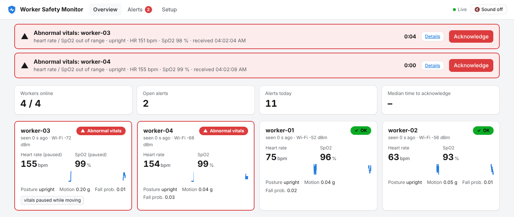
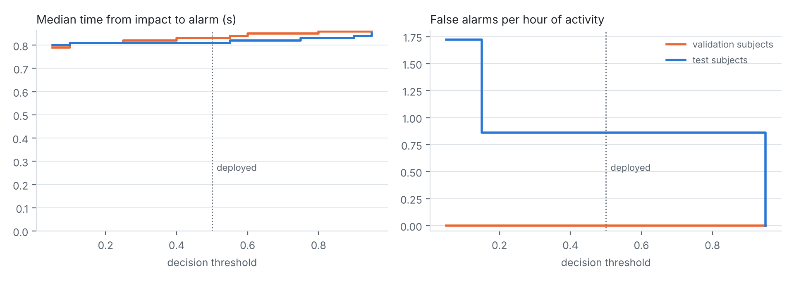
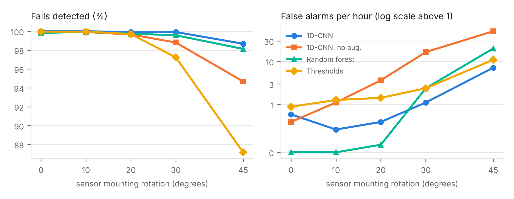

# Edge-AI Worker Safety Monitor

A waist-worn wearable (ESP32 + MPU6050 IMU + MAX30102 pulse oximeter) that detects
falls and collapses **on the device** with a tiny int8 1D-CNN, watches heart rate and
SpO2, and alerts a supervisor's web app over Wi-Fi.

| I want to... | Go to |
|---|---|
| Build the real device and demo it (parts, wiring, browser flashing, phone setup) | [`HARDWARE.md`](HARDWARE.md) |
| Run the supervisor web app (or try it with simulated workers) | `python webapp/server.py --demo 3`, then http://localhost:8080 |
| Show a live demo without any hardware (firmware in the ESP32 emulator) | [`DEMO.md`](DEMO.md) |
| Read the paper and its results | [`paper/main.pdf`](paper/main.pdf), [`research/RESULTS.md`](research/RESULTS.md) |
| Change the firmware | [`firmware/README.md`](firmware/README.md) |
| Retrain the model | *Usage* below |

- **Phase 1 (model):** the training pipeline and the model files, in this folder.
- **Phase 2 (firmware):** the ESP32 / ESP32-S3 application in [`firmware/`](firmware/README.md),
  with a phone setup page, orientation calibration and ready-made images. It is checked
  against the Python pipeline and in the ESP32 emulator on every push (*firmware*
  workflow under Actions), but **has not yet run on a real board**.
- **Supervisor web app:** [`webapp/`](webapp/README.md), Python standard library only.



- **Research:** [`research/`](research/RESULTS.md) (cross-validated baselines,
  ablations, robustness) and the paper in [`paper/`](paper/main.tex).

## Contents

| File | What it is |
|---|---|
| `phase1_pipeline.py` | End-to-end pipeline: load KFall → filter/resample to 50 Hz → window → train → pick threshold → int8 quantise → evaluate → export firmware header |
| `fall_model_data.h` | Copy into the ESP32 project: int8 model bytes, normalisation, low-pass filter coefficients, quantisation params, threshold, TFLM op list |
| `fall_model_int8.tflite` | int8 model for TensorFlow Lite Micro (18.6 kB) |
| `fall_cnn.keras` | float32 Keras model |
| `results.md`, `results.json` | Metrics on unseen test subjects + 5-fold subject-wise cross-validation |
| `evaluate_deployment.py`, `deployment_eval.*` | Device-level evaluation: false alarms per hour, time to alarm, threshold sweep |
| `fig_training_curves.png`, `fig_roc.png`, `fig_confusion_int8.png` | Figures for the paper |
| `firmware/` | Phase 2: ESP32 firmware, C port of the pipeline, tests ([README](firmware/README.md)) |
| `webapp/` | Supervisor web app: live dashboard, alerts and acknowledgments, history, setup page with browser flasher, simulator, tests |
| `HARDWARE.md`, `docs/wiring.svg` | Parts list, wiring, flashing, phone setup, calibration, demo script, troubleshooting |
| `research/` | `experiments.py` (5-fold CV of the CNN, ablations, random forest and threshold baselines, sensor-rotation robustness, statistics) and its results |
| `paper/` | IEEE-format paper (`main.tex`, `refs.bib`, `main.pdf`) |
| `docs/Project_Report.pdf`, `docs/Project_Report.docx` | Detailed project report (Phase 1 and Phase 2; written before the web app, hardware kit and cross-validated results) |
| `docs/Presentation.pptx`, `docs/Presentation.pdf` | 14-slide presentation with speaker notes (same date as the report); the name line on the title slide is editable |
| `DEMO.md` | How to run the live demo for an audience, no board needed |
| `Snehitha_project.zip` | Original upload of Phase 1 (an earlier run, kept for reference) |

## Dataset

[KFall](https://doi.org/10.3389/fnagi.2021.692865): 32 subjects, 21 activity types +
15 fall types, low-back IMU at 100 Hz, with expert-labelled fall onset/impact frames.

KFall is **not** openly licensed: access is granted on request, and the dataset may not
be passed on to third parties. Request your own copy from the
[KFall project page](https://sites.google.com/view/kfalldataset), then unzip it into a
folder (e.g. `kfall/`) that contains `sensor_data_new/` and `label_data_new/`.

## Setup

```bash
pip install -r requirements.txt
```

Tested with Python 3.13 and TensorFlow 2.21.

## Usage

```bash
python phase1_pipeline.py --data kfall --cv 5
```

- Outputs go to `phase1_outputs/` (change with `--out`). The first run caches the
  parsed dataset as `kfall_cache.npz` there, so later runs start in seconds.
- `--synthetic` runs a ~15 s smoke test without any dataset.
- `--dataset sisfall --data path/to/SisFall_dataset` uses SisFall instead (not yet run).
- A full run with `--cv 5` takes about 20 minutes on a 4-core CPU.

## Results (KFall, 6 test subjects never seen in training)

int8 model (the one that runs on the ESP32), threshold 0.50, alarm after 2 consecutive
positive windows:

| Level | Accuracy | Sensitivity | Specificity | F1 |
|---|---|---|---|---|
| Per window | 99.93 % | 100.00 % | 99.92 % | 99.77 % |
| Per recording (deployment) | 99.90 % | 100.00 % | 99.81 % | 99.89 % |

All 441 test falls detected; 1 false alarm out of 516 normal-activity recordings.
5-fold subject-wise CV: per-recording sensitivity 100.00 ± 0.00 %, specificity
99.86 ± 0.28 %. Full tables in [`results.md`](results.md).

### As the device runs it ([`deployment_eval.md`](deployment_eval.md))

`evaluate_deployment.py` replays every validation and test recording through the
firmware's exact decision rule:

| | Test subjects | Validation subjects |
|---|---|---|
| Falls detected | 441 / 441 | 297 / 297 |
| Time from impact to alarm (median / 95th percentile) | 0.81 s / 1.08 s | 0.83 s / 1.08 s |
| False alarms during normal activity | 1 in 1.16 h (0.9 / h, 95 % CI 0.0–4.8) | 0 in 0.82 h |

KFall's activity clips are dense with hard movements, so the false-alarm rate is a
pessimistic bound for a normal shift. Every threshold from 0.05 to 0.95 detects all
falls; the threshold now sits in the middle of the range the validation subjects
support (it used to take the lowest, 0.05, which doubled the false alarms).



The heart-rate / SpO2 algorithms and the alert rules are checked only on synthetic
signals so far: **not clinically validated**.

## Cross-validated results and baselines ([`research/RESULTS.md`](research/RESULTS.md))

`research/experiments.py` tests every one of the 5,057 KFall recordings once, by a
model that never saw its subject (5-fold subject-wise CV), with the device's decision rule:

| Method | Falls detected | Specificity | False alarms / h | Median time to alarm |
|---|---|---|---|---|
| **1D-CNN (deployed), int8 18.6 kB** | **2346 / 2346** | 99.82 % | 0.79 | 0.82 s |
| Random forest, 38 features (~0.5 MB) | 2342 / 2346 | 100.00 % | 0.00 | 0.86 s |
| Impact + posture thresholds | 2345 / 2346 | 99.78 % | 0.95 | 3.08 s |

On KFall the three are statistically tied (exact McNemar p ≥ 0.38). What separates them
is how the device is worn: with the sensor mounted **45° off**, the CNN still detects
98.7 % of falls (7.1 false alarms/h), the same CNN trained without rotation augmentation
94.7 % (50.3/h), the random forest 98.1 % (20.0/h) and the threshold rule 87.2 %. The
firmware's two-pose calibration keeps a worn device close to 0°.



## Phase 2 firmware in short

See [`firmware/README.md`](firmware/README.md). Beyond running the model, the device:

- raises a **man-down** alarm when the worker lies motionless for 30 s (or stands
  motionless for 3 min), which catches a collapse with no impact;
- pauses **vitals alerts while the worker moves vigorously**, when the PPG is unreliable;
- reports a **frozen or missing motion sensor** to the supervisor;
- keeps alerts in a **store-and-forward** queue until the supervisor confirms them;
- shows the supervisor's **acknowledgment** to the worker ("help is on the way");
- sends posture, impact force, heart rate and SpO2 with every alert;
- is configured from a phone (setup Wi-Fi network and page), calibrates its orientation
  in two poses, and can play a safe **demo fall** (double press) for presentations.

**Live demo without a board:** see [`DEMO.md`](DEMO.md). One Docker command runs the
firmware in the ESP32 emulator in real time while the supervisor page shows the
alerts, which you acknowledge by clicking.

Without a board, everything is checked automatically on every push: the C code against
the Python pipeline (identical decisions on all 957 KFall test recordings), real
ESP-IDF builds for ESP32 and ESP32-S3, and a 250 s scenario run in the ESP32 emulator.

## Still to do

**On real hardware** (the software is written and tested without a board; see [`HARDWARE.md`](HARDWARE.md))
- Build the device, flash it, calibrate it, run the demo script
- Measure on the device: inference time (printed at boot as `MODEL BENCHMARK`; fill it
  into the paper), battery life
- Tune the man-down and vitals-motion settings on real workers
- LoRa alert link (Wi-Fi works now)

**Validation (for the paper)**
- Cross-dataset test on SisFall (`--dataset sisfall` is supported) and recordings from the device itself
- Calibrate SpO2 against a reference oximeter
- Real-world tests with the device; report false alarms per hour of wear
- Validation subjects that are harder for the model, so the threshold choice is data-driven
  rather than "middle of a perfect plateau"
