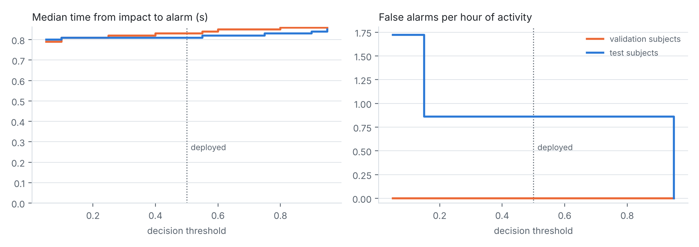

# Deployment evaluation (int8 model, firmware decision rule)

Every recording of the validation and test subjects is replayed exactly as the device runs it: a 2.56 s window every 0.5 s, alarm after 2 consecutive windows with probability >= threshold. Latency = alarm time minus the labelled impact.

| Subjects, threshold | Falls detected | False alarms (normal activity) | ADL recordings with an alarm | Median latency | 95th pct latency | Alarm within 1 s |
|---|---|---|---|---|---|---|
| Test, 0.50 (deployed) | 441/441 | 1 in 1.16 h: 0.9/h (95% CI 0.0-4.8) | 1/516 | +0.81 s | +1.08 s | 85 % |
| Test, 0.05 (lowest tied: previous rule) | 441/441 | 2 in 1.16 h: 1.7/h (95% CI 0.2-6.2) | 2/516 | +0.80 s | +1.05 s | 88 % |
| Validation, 0.50 (deployed) | 297/297 | 0 in 0.82 h: 0.0/h (95% CI 0.0-4.5) | 0/344 | +0.83 s | +1.08 s | 84 % |
| Validation, 0.05 (lowest tied: previous rule) | 297/297 | 0 in 0.82 h: 0.0/h (95% CI 0.0-4.5) | 0/344 | +0.79 s | +1.04 s | 89 % |

KFall activity clips are short and dense with difficult movements (jumps, stumbles, sitting down hard), so false alarms per hour here are a pessimistic upper bound for a normal shift, and with so few events the interval is wide. On the device each false alarm first opens the 10 s cancel window; it only reaches the supervisor if the worker neither presses "I'm OK" nor moves.

## Threshold choice

The pipeline picks the threshold with the best window-level F1 on the validation subjects. Every threshold from 0.05 to 0.95 ties at F1 = 1.0000, so the pipeline takes the middle of the tied range (0.50), the choice furthest from both failure modes. Its previous rule took the lowest tied value (0.05): on the test subjects that gives 2 false alarms instead of 1 and detects 0 more falls.

Falls detected at every threshold from 0.05 to 0.95: validation 100 %, test 100 % (worst case over the sweep). Raising the threshold mainly removes false alarms and adds a little latency. Picking the threshold from the test-subject curve would over-fit; only the validation subjects may choose it.

## False alarms by activity (test subjects, deployed threshold)

| KFall task | False alarms |
|---|---|
| T05 | 1 |

Task numbers are KFall's file naming (S..T<task>R..); see the KFall paper for the activity names.
