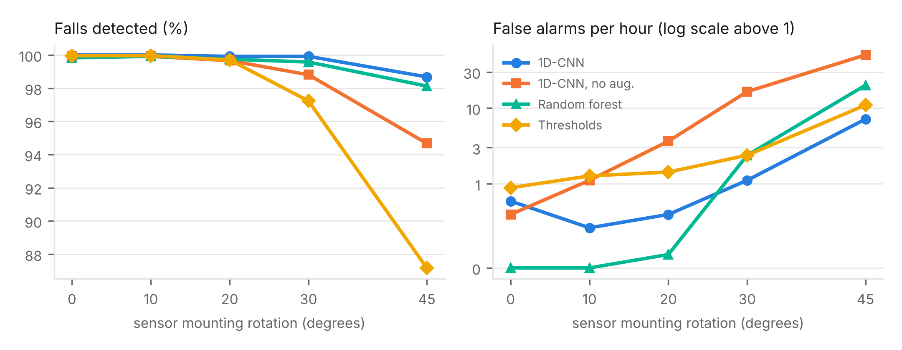
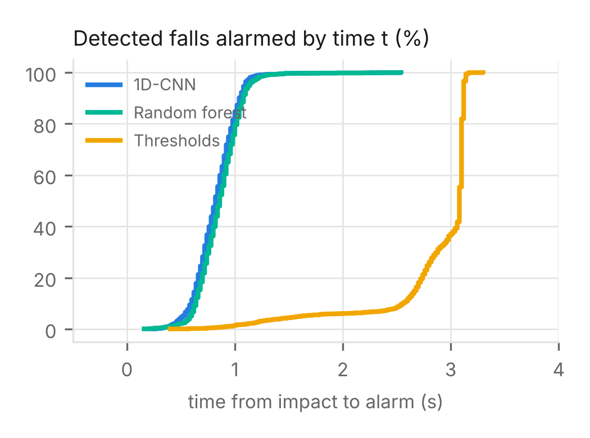

# Research results: 5-fold subject-wise cross-validation on KFall

All 5057 recordings of the 32 KFall subjects, each tested once by the fold model that never saw its subject. Device decision rule: a window every 0.5 s, alarm after 2 consecutive positive windows. Brackets: 95 % subject-level bootstrap confidence intervals. Generated by `research/experiments.py`.

## Methods

| Method | Falls detected | Sensitivity % | Specificity % (recordings) | F1 % | False alarms / h | Median latency | p95 latency | Model size |
|---|---|---|---|---|---|---|---|---|
| 1D-CNN (deployed) | 2346/2346 | 100.00 [100.0, 100.0] | 99.82 [99.6, 100.0] | 99.89 | 0.79 [0.0, 1.8] | +0.82 s | +1.10 s | 7,169 params, 349k MACs, int8 18.8 kB |
| 1D-CNN, no augmentation | 2344/2346 | 99.91 [99.8, 100.0] | 99.85 [99.7, 100.0] | 99.87 | 0.64 [0.0, 1.5] | +0.82 s | +1.10 s | 7,169 params, 349k MACs, int8 19.2 kB |
| 1D-CNN, accelerometer only | 2346/2346 | 100.00 [100.0, 100.0] | 99.85 [99.6, 100.0] | 99.91 | 0.64 [0.0, 1.8] | +0.84 s | +1.11 s | 6,833 params, 306k MACs, int8 18.9 kB |
| 1D-CNN, 1.28 s window | 2343/2346 | 99.87 [99.6, 100.0] | 99.78 [99.5, 100.0] | 99.81 | 0.95 [0.0, 2.3] | +0.78 s | +1.06 s | 7,169 params, 175k MACs, int8 19.3 kB |
| 1D-CNN, 3.84 s window | 2346/2346 | 100.00 [100.0, 100.0] | 99.78 [99.5, 100.0] | 99.87 | 0.95 [0.0, 2.3] | +0.92 s | +1.86 s | 7,169 params, 523k MACs, int8 19.3 kB |
| Random forest, 38 features | 2342/2346 | 99.83 [99.6, 100.0] | 100.00 [100.0, 100.0] | 99.91 | 0.00 [0.0, 0.0] | +0.86 s | +1.14 s | 49,496 tree nodes |
| Impact + posture thresholds | 2345/2346 | 99.96 [99.9, 100.0] | 99.78 [99.5, 100.0] | 99.85 | 0.95 [0.2, 2.1] | +3.08 s | +3.12 s | 2 thresholds (|a| > 1.8 g, tilt > 60 deg in fold 1) |

## Paired comparison with the deployed CNN (exact McNemar test, recording level)

| Method | Only CNN correct | Only this method correct | p |
|---|---|---|---|
| cnn_consec1 | 1 | 0 | 1 |
| cnn_consec3 | 4 | 1 | 0.38 |
| 1D-CNN, no augmentation | 4 | 3 | 1 |
| 1D-CNN, accelerometer only | 2 | 3 | 1 |
| 1D-CNN, 1.28 s window | 8 | 4 | 0.39 |
| 1D-CNN, 3.84 s window | 3 | 2 | 1 |
| Random forest, 38 features | 4 | 5 | 1 |
| Impact + posture thresholds | 6 | 4 | 0.75 |

## Consecutive positive windows before an alarm (deployed CNN, no retraining)

| Windows | Sensitivity % | False alarms / h | Median latency |
|---|---|---|---|
| 1 | 100.00 | 0.95 | +0.32 s |
| 2 | 100.00 | 0.79 | +0.82 s |
| 3 | 99.83 | 0.64 | +1.32 s |

## Sensor mounted rotated (random axis per recording)

| Method | 0 deg | 10 deg | 20 deg | 30 deg | 45 deg |
|---|---|---|---|---|---|
| 1D-CNN (deployed) | 100.00 % / 0.8 per h | 100.00 % / 0.5 per h | 99.91 % / 0.6 per h | 99.91 % / 1.1 per h | 98.68 % / 7.1 per h |
| 1D-CNN, no augmentation | 99.91 % / 0.6 per h | 99.91 % / 1.1 per h | 99.66 % / 3.7 per h | 98.81 % / 16.5 per h | 94.67 % / 50.3 per h |
| Random forest, 38 features | 99.83 % / 0.0 per h | 99.91 % / 0.0 per h | 99.74 % / 0.2 per h | 99.57 % / 2.4 per h | 98.12 % / 20.0 per h |
| Impact + posture thresholds | 99.96 % / 1.0 per h | 99.96 % / 1.3 per h | 99.70 % / 1.4 per h | 97.23 % / 2.4 per h | 87.17 % / 11.0 per h |

Each cell: falls detected / false alarms per hour.

## Per-fold mean ± std

| Method | Sensitivity % | Specificity % | False alarms / h |
|---|---|---|---|
| 1D-CNN (deployed) | 100.00 ± 0.00 | 99.82 ± 0.27 | 0.77 ± 1.16 |
| 1D-CNN, no augmentation | 99.92 ± 0.16 | 99.86 ± 0.13 | 0.61 ± 0.55 |
| 1D-CNN, accelerometer only | 100.00 ± 0.00 | 99.86 ± 0.28 | 0.60 ± 1.20 |
| 1D-CNN, 1.28 s window | 99.88 ± 0.24 | 99.79 ± 0.33 | 0.92 ± 1.45 |
| 1D-CNN, 3.84 s window | 100.00 ± 0.00 | 99.79 ± 0.34 | 0.89 ± 1.46 |
| Random forest, 38 features | 99.83 ± 0.21 | 100.00 ± 0.00 | 0.00 ± 0.00 |
| Impact + posture thresholds | 99.96 ± 0.08 | 99.78 ± 0.25 | 0.93 ± 1.10 |
