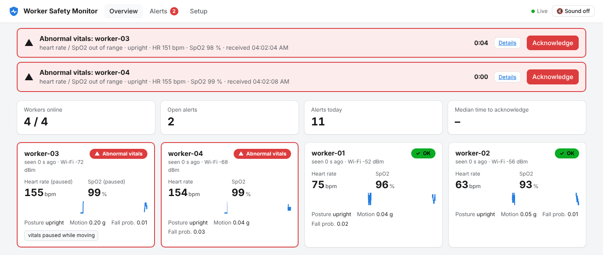
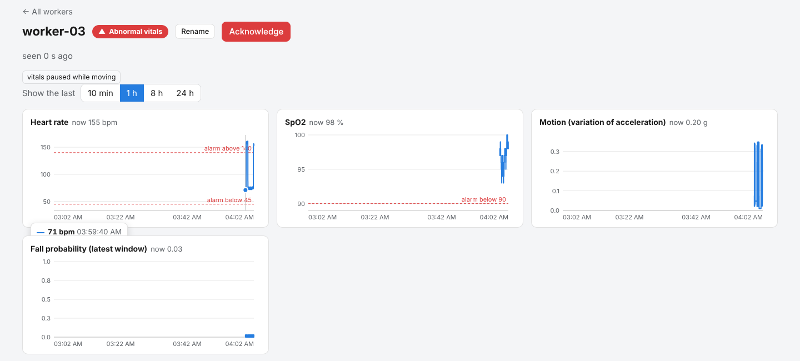

# Supervisor web app

Live monitoring for the worker safety devices. Python 3.9+ standard library only:
nothing to install.

```bash
python webapp/server.py
```

Open http://localhost:8080/ on this computer. The console also prints the address the
devices must use (for example `http://192.168.43.17:8080`); the **Setup** page shows it
too. To try the app without hardware:

```bash
python webapp/server.py --demo 3
```

## What it does





*(Screenshots with simulated workers.)*


- **Overview:** one card per worker with status (OK, pre-alarm, alert, help on the way,
  sensor fault, offline), heart rate and SpO2 with 10-minute trends, posture, motion,
  Wi-Fi signal and notes such as "vitals paused while moving".
- **Alarm banner** on every page for each open alert, with the time since it arrived and
  an **Acknowledge** button; the acknowledgment reaches the device in its next reply and
  the worker hears "help is on the way". Optional alarm sound and desktop notifications.
- **Worker page:** charts of heart rate, SpO2, motion and fall probability over 10 min to
  24 h with tooltips, device details (firmware, IP, inference time, calibration), its
  alerts, rename, and **Simulate a fall (demo)** for devices with the demo feature.
- **Alerts:** full history with filters, who acknowledged and how fast, CSV export.
- **Setup:** the server address for the devices, a browser flasher for the firmware
  (Chrome or Edge, after `python webapp/get_firmware.py`), and a test alert.
- History in SQLite (`webapp/data/safety.db`), so it survives a restart; a simple page
  without JavaScript at `/simple`.

## Options

| Option | |
|---|---|
| `--port 8090` | another port |
| `--db FILE` | database file (`:memory:` keeps nothing) |
| `--token SECRET` | devices must send `X-Device-Token: SECRET` (set the same token on the device's setup page) |
| `--password SECRET` | the browser asks for a password |
| `--offline-after 90` | seconds without a report before a worker shows as offline |
| `--demo N` | also run N simulated workers |
| `--log FILE` | append every message to a JSON-lines file |
| `--auto-ack S` | acknowledge alerts automatically after S seconds (tests only) |

## Device protocol

Devices POST JSON to `/alert` and `/telemetry` (see `firmware/main/net.c`). Every reply
is `{"ok": true, "acked": [ids...]}` with the worker's acknowledged alert IDs, plus
`"cmd": "demo_fall"` once after the demo button was clicked. Alerts are de-duplicated
by ID, so the device's store-and-forward retries are safe.

Browser API: `GET /api/state`, `GET /api/stream` (Server-Sent Events), `GET /api/history`,
`GET /api/alerts`, `GET /api/alerts.csv`, `GET /api/info`, `POST /api/ack`,
`POST /api/workers/<id>`, `POST /api/workers/<id>/demo-fall`, `POST /api/test-alert`.

## Tests

```bash
python webapp/test_server.py -v
```

`simulate.py` runs the same scenarios as the firmware (fall, cancelled fall, racing
heart, man-down, sensor fault) and is used by the tests and by `--demo`.
